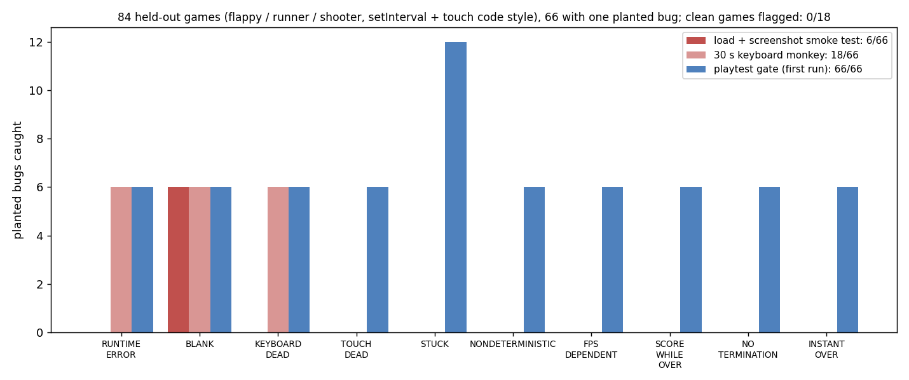

# Playtest gate for AI-generated browser games

> Unofficial prototype by Kushagra Pratap Singh. Not affiliated with Instaplay or General Context Labs.

## The problem
[Instaplay](https://instaplay.ai/) turns a prompt into a playable browser game for web and Android, with 100,000+ monthly players ([launch post](https://www.ycombinator.com/launches/SPs-instaplay-make-and-play-anything)). Its guide tells creators to "play it yourself before you send it anywhere" ([guide](https://instaplay.ai/blog/how-to-make-a-game-with-ai)), and generations are limited to two a day.

The bugs that hurt most don't show up when the game loads:
- **Controls that don't work in real use:** taps do nothing on a phone, or key listeners sit on a canvas that never gets focus.
- **Late failures:** a crash after 8 seconds, or a game-over screen that ignores "restart".
- **Speed tied to frame rate** (`x += speed` per frame), so the game runs at half speed on a 30 fps phone.

If games are also used as **RL environments**, three more things matter:
- the same seed and actions must replay the same frames;
- episodes must end;
- score must not keep rising on the game-over screen.

## What I built
`harness/` (Node + puppeteer-core + headless Edge/Chrome) plays a single-file HTML5 canvas game and returns PUBLISH or FIX, with evidence for each finding.
- **`shim.js`** is injected before the game's own scripts:
  - **virtual time:** `requestAnimationFrame`, `setTimeout`/`setInterval` (coalesced once per frame, like a busy phone), `Date` and `performance.now`;
  - **randomness:** `Math.random` is seeded; `crypto.getRandomValues` is counted;
  - **errors** are captured;
  - **input behaves like a real browser:** keys go to the focused element, there's no `keypress` for arrow keys, and taps fire pointer, touch and mouse events, with mouse events suppressed when the page cancels the touch;
  - **frames** are hashed every 100 ms.
- **`playtest.js`** runs each game seven ways: idle, keyboard monkey ×2, touch monkey, 60 vs 30 fps, and a 60-s mixed run that pauses on the first game-over screen. Findings:
  - `RUNTIME_ERROR`, `BLANK`, `KEYBOARD_DEAD`, `TOUCH_DEAD`;
  - `STUCK`: frozen frames while inputs keep arriving, in both keyboard and touch play;
  - `NONDETERMINISTIC`: names the unseeded source;
  - `FPS_DEPENDENT`: the 30 fps game at time t matches the 60 fps game at half the elapsed time;
  - with a two-function contract `window.__game = {score(), over()}`: `INSTANT_OVER`, `NO_TERMINATION` and `SCORE_WHILE_OVER`.
- **Baselines:**
  - a load-and-screenshot smoke test (3 s: errors, blank);
  - a 30-s keyboard monkey (errors, blank, no frame change).

```
$ python demo.py
games/dev/dodger-notouch-0.html        gate: FIX   smoke test: PUBLISH
    TOUCH_DEAD        taps produced exactly the same frames as doing nothing (20 s): unplayable on a phone
games/dev/dodger-fps-0.html            gate: FIX   smoke test: PUBLISH
    FPS_DEPENDENT     at 30 fps the game at time t looks like the 60 fps game at half the elapsed time (diff 0.2 vs 2.8)
games/heldout/runner-scoreover-0.html  gate: FIX   smoke test: PUBLISH
    SCORE_WHILE_OVER  score rose 2 -> 3 on the game-over screen (run kb1, t=7.6 s): reward without playing
games/heldout/flappy-restart-0.html    gate: FIX   smoke test: PUBLISH
    STUCK             frames frozen 29.1 s from t=0.9 s with 137 key presses, and 27.4 s with 140 taps
```

## Results: held-out
`games/build.py` writes single-file games from templates, each with at most one planted bug (11 kinds) or clean (18 per split).
- **Dev:** dodger, breakout and snake, written in loop style A: `requestAnimationFrame`, window key listeners, pointer events. I calibrated the frame-rate threshold and two rules on dev only:
  - a frozen game never signals game over, so `NO_TERMINATION` after `STUCK` isn't counted as false;
  - the thumbnail size for the frame-rate check.
- **Held-out:** flappy, runner and shooter, written in a different loop style B: `setInterval`, `document` key listeners by `e.code`, touch + mouse events. These were committed to git before the first held-out run (commit `16fe608`) and never run while building.



| 84 held-out games, 66 with a planted bug | Smoke test | 30-s keyboard monkey | Playtest gate (first run) |
|---|---|---|---|
| Planted bugs caught | 6 | 18 | **66** |
| Clean games flagged (of 18) | 0 | 0 | **0** |
| Other false findings | 0 | 0 | **0** |

Nothing was changed after the held-out run.

## Run it
```bash
npm install                  # puppeteer-core; uses installed Edge (set BROWSER=/path/to/chrome elsewhere)
python demo.py               # five games: gate verdict + evidence vs smoke test
python evaluate.py heldout   # 84 held-out games (~2.5 min)
```
`python -m pytest -q tests` runs 6 tests (needs the browser).

## Honest limits
- **I wrote both the games and the bugs.** The held-out set tests new game mechanics and a different code style, not new kinds of bugs. A perfect score here says the checks generalise across code styles, not that they find every bug real generated games have. The next step would be a few hundred real generated games, labelled by hand.
- **2D canvas only.** No WebGL/3D, audio, multiplayer or networking, and no judgement of whether a game is fun or matches its prompt.
- **The RL checks need the two-function `window.__game` contract,** which a generator would have to emit. Without it, those three checks are skipped.
- **Thresholds are from 6 dev games.** The frame-rate check compares thumbnails. A game that legitimately changes behaviour with frame rate, or whose physics are chaotic, may need a different check.
